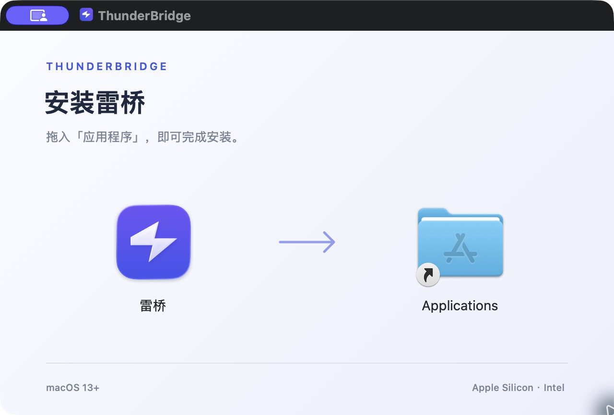

<div align="center">
  
  <h1>雷桥 · ThunderBridge</h1>
  <p><strong>一根线，两台 Mac。文件，自由往返。</strong></p>
  <p>为雷雳网桥设计的原生 macOS 文件传输工具。<br>浏览对方目录，拖入上传，选中下载。无需账号，无需云端中转。</p>
  <p>
    <a href="https://github.com/YujieYang-ZJU/ThunderBridge/releases/latest"></a>
    
    <a href="LICENSE"></a>
  </p>
  <p><a href="https://github.com/YujieYang-ZJU/ThunderBridge/releases/download/v0.4.1/ThunderBridge-v0.4.1-macOS-universal.dmg"><strong>下载 macOS 版 ↗</strong></a>　·　<a href="#开始使用">开始使用</a>　·　<a href="https://github.com/YujieYang-ZJU/ThunderBridge/releases">版本记录</a></p>
</div>

<br>


<p align="center"><sub>真实应用界面，使用独立演示数据。设备名、地址、目录与文件均为示例，不包含私人文件信息。</sub></p>

<details>
<summary>查看主界面静态截图</summary>


</details>

## 让文件传输回到简单

| 连接即发现 | 文件双向流动 | 每一份都有核验 |
| :--- | :--- | :--- |
| 两边开启共享，自动识别对方。无需输入 IP、端口或连接码。 | 从 Finder 拖入上传，选中对方文件下载。文件夹也可以整批传。 | 接收后重新读取文件，核对 SHA-256，并支持导出校验报告。 |
| **中断也能继续**<br>暂停、断线或重启后，重新连接原设备即可手动续传。 | **重复投递更省事**<br>跳过相同内容，收藏目录，保存常用投递方案。 | **为 Mac 而生**<br>SwiftUI 原生界面，宽敞文件列表，⌘ / ⇧ 多选，可收起侧栏和队列。 |

## 进度与结果，都看得见

展开传输队列，查看上传、下载、暂停状态和核验结果。文件浏览区与队列可调整高度，侧栏也可收起。


<sub>任务与文件大小为演示数据，不代表实际传输性能。</sub>

## 开始使用

### 01 · 拖一下，安装完成

下载 [ThunderBridge-v0.4.1-macOS-universal.dmg](https://github.com/YujieYang-ZJU/ThunderBridge/releases/download/v0.4.1/ThunderBridge-v0.4.1-macOS-universal.dmg)，双击打开，将 **雷桥** 拖到 **Applications（应用程序）**。安装后推出磁盘映像，从「应用程序」启动。

<p align="center"></p>

一个安装包同时支持 **Apple Silicon 与 Intel**，最低要求 **macOS 13**。也可从 [Release](https://github.com/YujieYang-ZJU/ThunderBridge/releases/latest) 下载 ZIP 版；SHA-256 校验文件一并提供。

当前构建使用本地签名，尚未进行 Apple 开发者签名与公证。首次启动时，可能需要在「系统设置 → 隐私与安全性」中允许打开可信构建。

### 02 · 两边开启共享

先用支持雷雳的线缆连接两台 Mac，并在 macOS 网络设置中配置雷雳网桥。在两边打开雷桥、选择各自的网桥地址，点击 **开启本机共享**。

只有一台可用 Mac 时自动连接；发现多台时，在「附近的 Mac」中选择。首次启动请允许本地网络访问及入站连接。v0.4.1 已修复网桥连通却提示「所选网络不可用」的问题。

### 03 · 选好目录，开始传输

| 上传到对方 | 下载到本机 |
| :--- | :--- |
| 双击进入对方目标目录，点击「上传文件…」选择项目，再点击「开始传输」。也可从 Finder 拖入，默认立即发送。 | 在对方列表中选择文件或文件夹，点击「下载所选…」，选择本机保存位置。支持 ⌘ / ⇧ 多选及右键下载。 |

建议两端均使用 v0.4.1，与 v0.4.0 的传输协议兼容。也可使用其他可达的本地 IPv4 接口；自动发现与连接限定在所选网络，不会自动改走 Wi-Fi。

## 共享范围，由你开启

> **仅在可信网络开启共享。** 共享默认关闭，开启后，同一所选网络上的设备可浏览、下载和写入当前用户及应用有权访问的目录。停止共享会撤下广播并断开连接。

无码模式不进行设备身份认证。TLS 使用临时密钥交换加密传输，不能防止主动冒充设备；访问受保护目录仍需 macOS 授权。

<details>
<summary><strong>文件处理方式与当前限制</strong></summary>

- 默认开启「只传变化文件」：同名同内容跳过；同名但内容不同，另存为带序号的副本，保留原文件。不删除目标中多出的文件。
- 支持普通文件与文件夹，包含中文名称、隐藏文件和空目录。保留修改时间与基本权限。
- 不完整保留扩展属性、Finder 标签等元数据，暂不支持符号链接与特殊文件；需要时可先在 Finder 中压缩。
- 用于文件传输，不提供镜像同步或完整系统备份。速度取决于网络和磁盘，准备与校验阶段也会读取文件。
- 找不到对方时，检查两边是否均开启共享、网络选择是否正确，以及本地网络权限与防火墙设置。

</details>

<details>
<summary><strong>版本验证情况</strong></summary>

v0.4.1 已通过 45 项自动化测试，覆盖本机 Bonjour 自动发现、无连接码双向传输、重连、停止共享、加密协商与原有文件传输流程。已在实际雷雳网桥上验证接口识别与限定接口监听。

两台实体 Mac 的完整传输、吞吐量与长期稳定性仍待实测；Intel 与 macOS 13 兼容性目前仅完成交叉构建。README 中的截图使用独立演示数据。

</details>

## 从源码构建

应用使用 SwiftUI，仅依赖 Apple 系统框架。建议使用 Swift 6+ 工具链；测试需 macOS 14+。DMG 打包另需 Python 3，脚本会在临时环境安装固定版本的 `dmgbuild`，完成后自动清理。

```sh
# 构建通用 App、ZIP 与 DMG，输出到 dist/
bash scripts/build-app.sh

# 已有 App 时，仅制作 DMG
bash scripts/build-dmg.sh "dist/雷桥.app" dist

# 运行测试
bash scripts/test.sh
```

核心传输逻辑位于 `Sources/BridgeCore`，界面位于 `Sources/ThunderBridge`。DMG 输出已存在时，打包脚本会停止，请使用新的输出目录或先移走旧文件。

---

<p align="center"><a href="LICENSE">MIT License</a> · Copyright © 2026 Yang Yujie<br><sub>Built with SwiftUI. Made for a direct connection.</sub></p>
